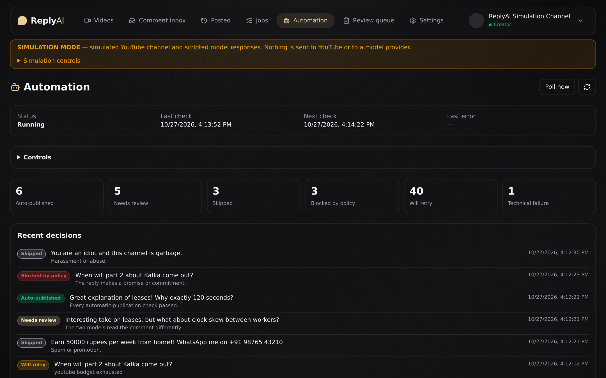
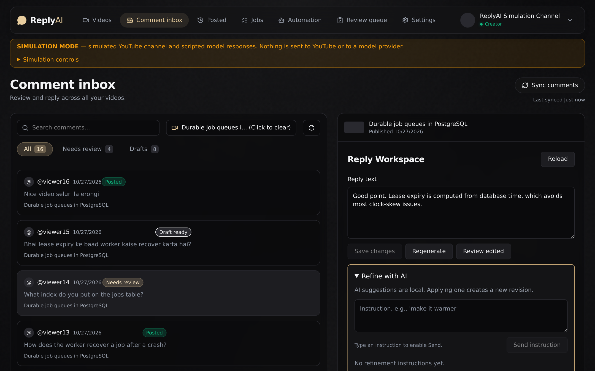
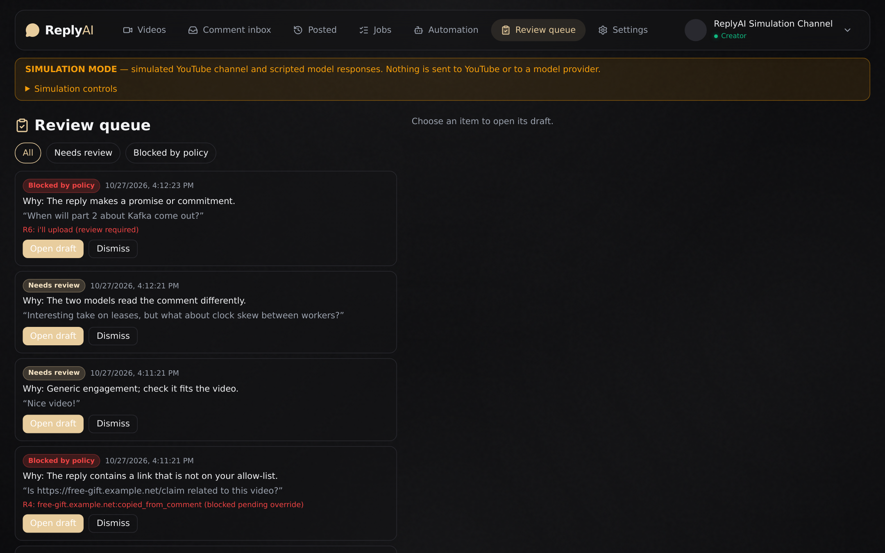
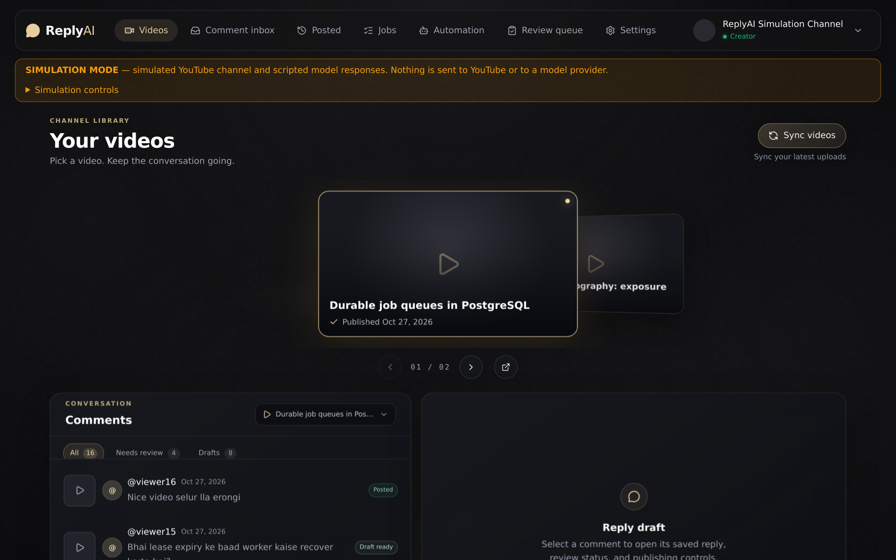
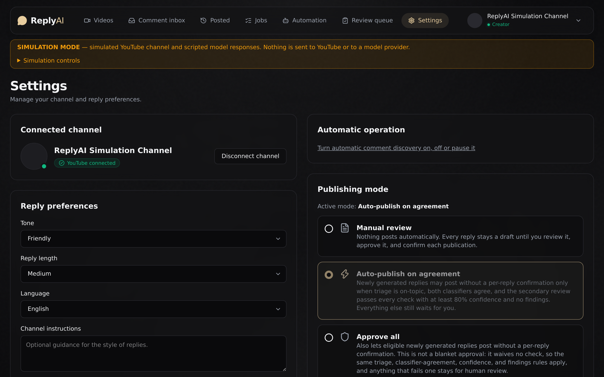
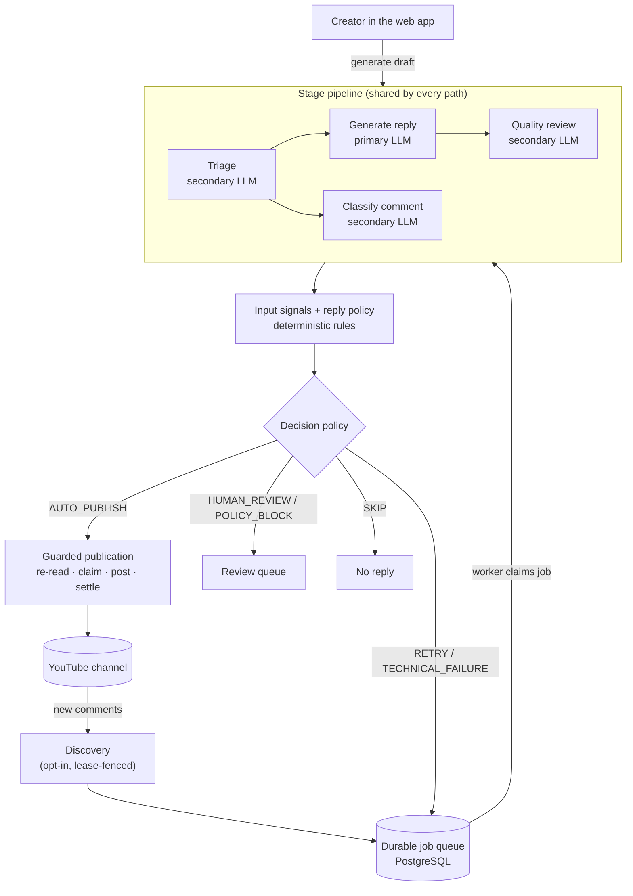

# ReplyAI

**YouTube comment replies drafted by one LLM, independently verified by a second, and
published only when a deterministic safety policy agrees.**



<sub>Screenshots in this README are captured from the running application in its built-in
simulation mode: a fake channel and scripted models, so no real viewer data is shown.</sub>

## Why ReplyAI

A growing channel receives more comments than its creator can answer. Many deserve a
reply: questions about the video, thanks, corrections. Many do not: spam, abuse,
off-topic requests, attempts to make the channel say something it shouldn't.

Asking a single LLM to "reply helpfully" fails in predictable ways. It answers questions
the video never covered, invents facts, echoes a viewer's phone number back to them,
promises a follow-up video, or follows instructions hidden in the comment. Once a
reply is published in the creator's name, it cannot be taken back quietly.

ReplyAI treats automatic replying as a decision problem, not a text-generation problem:

- a **primary model** writes the reply;
- a **secondary model** independently triages the comment, classifies it, and reviews the
  saved reply;
- **deterministic code** checks the input for concealed instructions and the reply for
  personal data, unapproved links, promises and hidden characters;
- one **decision policy** combines everything into a single, recorded outcome, and only
  then can a reply reach YouTube, through a publication path designed so that a comment
  can never be answered twice.

The creator stays in control: automation is off by default, every automatic decision is
explained, and anything uncertain lands in a review queue.

## Screenshots

| | |
| :---: | :---: |
|  |  |
| **Comment inbox**: drafts, model verdicts and the publish flow | **Review queue**: everything a person should decide, with reasons |
|  |  |
| **Videos**: the connected channel's uploads | **Settings**: publishing mode, reply preferences, allow-lists |

## Features

| | |
| --- | --- |
| **Dual-LLM verification** | Generation and verification run on different, separately configured models. Agreement on sentiment and intent is required, and so is a passing quality review with at least 0.8 confidence and no findings. |
| **Automatic comment processing** | Opt-in discovery polls the channel for new comments and queues them in a durable PostgreSQL job queue processed by background workers. |
| **One accountable decision** | Every comment ends in exactly one class (`AUTO_PUBLISH`, `HUMAN_REVIEW`, `SKIP`, `POLICY_BLOCK`, `RETRY`, `TECHNICAL_FAILURE`), stored with its reasons and shown as a decision trace. |
| **Deterministic guardrails** | Input signals for hidden Unicode, bidi tricks, confusable URLs and injection phrases; reply rules for personal data, unapproved links and contacts, promises, promotion and hidden characters. |
| **Human review** | Model disagreements, low confidence, possible sarcasm, risky multi-part comments and edited comments go to a review queue instead of being guessed. |
| **Safe publication** | One reply per comment is enforced by a unique database guard; the comment is re-read right before posting; lost responses are marked `unknown` and never blindly retried. |
| **Reliable background work** | Lease-based job claims with heartbeats, crash recovery that resumes instead of repeating paid work, shared rate-limit budgets, and hourly/daily publication caps. |
| **English, Hindi and Hinglish** | Language-aware triage and reply rules that cover Devanagari and romanized Hindi. |
| **Context-aware replies** | Triage sees a "scope card" of the video (title, description excerpt, chapters); replies follow per-channel tone, length and language preferences. |
| **Simulation mode** | A fake channel and scripted models exercise every workflow locally while all safeguards run as real code. |

## How it works



The full design, including the job state machine, the decision order and the database
invariants, is in [docs/architecture.md](docs/architecture.md).

### When does a reply get posted automatically?

Only when **all** of these hold:

1. The creator has chosen an automatic publishing mode. The default is **Manual
   review**, and **Dry run** lets you watch every decision without posting anything.
2. Triage says the comment is on-topic and safe to answer.
3. Both models produced complete, schema-valid results, with no uncertain labels, and the
   generator and verifier are different models.
4. The models agree, and the secondary review passed every check with confidence ≥ 0.8
   and no findings.
5. No deterministic rule objects to the input or the reply.
6. The comment still exists, has not been edited, and has not been answered by the
   creator, as confirmed by re-reading it just before posting.
7. Hourly and daily publication caps have room.

Model agreement is necessary but never sufficient. A provider outage, timeout or rate
limit is treated as an infrastructure failure and retried or reported; it is never
mistaken for a judgement about the comment. And because the publication record is
committed before the reply is sent, a lost network response cannot lead to a duplicate
public reply.

## Tech stack

| Layer | Technology |
| --- | --- |
| Frontend | React 19, TypeScript 6, Vite 8, Tailwind CSS 4, lucide-react |
| Backend | Python 3.12, FastAPI, Pydantic v2, SQLAlchemy 2 (async, asyncpg), Alembic |
| Orchestration | LangGraph (optional engine) and a shared stage pipeline |
| Models | Any OpenAI-compatible chat-completions API in JSON mode with strict schemas; Groq `openai/gpt-oss-120b` (primary) and `openai/gpt-oss-20b` (secondary) by default |
| Data | PostgreSQL 17 (all durable state, queue, budgets), Redis 7 (video-metadata cache) |
| Integrations | Google OAuth 2.0 with PKCE, YouTube Data API v3, Fernet-encrypted tokens |
| Tooling | Docker Compose, uv, Ruff, oxlint |

## Getting started

Prerequisites: Python 3.12+, Node.js 22+, Docker with Compose.

```bash
git clone https://github.com/RD-blip1/ReplyAI.git
cd ReplyAI
cp .env.example .env
cp backend/.env.example backend/.env
cp frontend/.env.example frontend/.env.local

docker compose up -d --wait postgres redis

cd backend && python3 -m venv .venv && .venv/bin/pip install -e '.[dev]' \
  && .venv/bin/alembic upgrade head && cd ..
cd frontend && npm ci && cd ..

scripts/dev.sh start sim      # simulation mode: no Google account or API keys needed
```

Open <http://127.0.0.1:5173> and choose **Connect simulated channel**. Stop everything
with `scripts/dev.sh stop`.

To use a real channel, configure Google OAuth and the two LLM roles, then run
`scripts/dev.sh start real`. [docs/getting-started.md](docs/getting-started.md) walks
through both modes step by step.

| Mode | YouTube | Models | Needs |
| --- | --- | --- | --- |
| Simulation | Fake channel stored locally | Scripted per scenario | PostgreSQL only |
| Real | Your channel via OAuth | Your configured providers | Google OAuth client, LLM API keys |

## Repository structure

```text
ReplyAI/
├── backend/
│   ├── app/
│   │   ├── routers/      HTTP API: auth, YouTube, drafts, publication, automation, jobs
│   │   ├── services/     Model pipeline, decision policy, guardrails, queue, YouTube client
│   │   ├── models/       SQLAlchemy models
│   │   ├── middleware/   OAuth secret redaction
│   │   ├── worker.py     Background worker and discovery loop
│   │   └── simulation.py Development simulation mode
│   ├── alembic/          Database migrations
│   └── pyproject.toml
├── frontend/
│   └── src/
│       ├── pages/        Videos, inbox, posted, jobs, automation, review queue, settings
│       ├── components/   App shell, automation controls, simulation panel
│       ├── hooks/        Shared session and channel data
│       ├── lib/          API client and types
│       └── DraftPanel.tsx  Draft workspace
├── docs/                 Architecture, setup, configuration, development
├── scripts/dev.sh        Start, stop and inspect the local stack
└── compose.yaml          PostgreSQL and Redis
```

## Documentation

| Document | Contents |
| --- | --- |
| [Getting started](docs/getting-started.md) | Installation, simulation and real mode, troubleshooting |
| [Architecture](docs/architecture.md) | Components, model pipeline, job lifecycle, decision policy, publication safety, data model |
| [Configuration](docs/configuration.md) | Every environment variable and per-channel setting |
| [Development](docs/development.md) | Conventions, extension points, API overview, migrations, debugging |
| [Data retention](docs/data-retention.md) | What is kept, for how long, and what deletion removes |

## Project status

ReplyAI is an educational AI-agent engineering project, developed as a study of how
LLM-based agents fail in a real workflow and which engineering controls contain those
failures.

- **Implemented:** everything described above, including automatic discovery, the
  decision policy, guardrails, the review queue, reconciliation of unknown outcomes and
  simulation mode.
- **Verified so far:** with an automated test suite maintained alongside the project
  (scripted model responses and a simulated YouTube API, including concurrency tests on
  PostgreSQL), and in simulation mode.
- **Not yet verified:** accuracy with real models, end-to-end runs against a live
  channel, and a full manual browser test pass. The project has not had an independent
  security audit.

Treat it as a well-instrumented prototype, not a production service. If you connect a
real channel, start with **Dry run**.

## Contributing

1. Fork the repository and create a branch from `main`.
2. Set up the project with [docs/getting-started.md](docs/getting-started.md) and work in
   simulation mode.
3. Follow the conventions in [docs/development.md](docs/development.md). Changes to the
   publication path, decision policy or guardrails should explain how they preserve the
   safety properties described in [docs/architecture.md](docs/architecture.md).
4. Before opening a pull request, run `ruff check .` in `backend/` and `npm run lint` and
   `npm run build` in `frontend/`, and describe what you verified.

Never commit `.env` files, OAuth client files, keys or real channel data.

## License

No license has been chosen for this repository yet. Until one is added, the code is
published for reading and evaluation only; no permission to reuse, modify or redistribute
it is granted.
