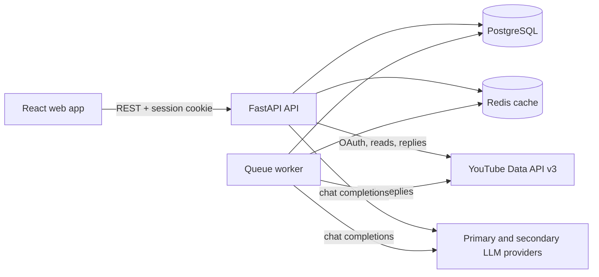
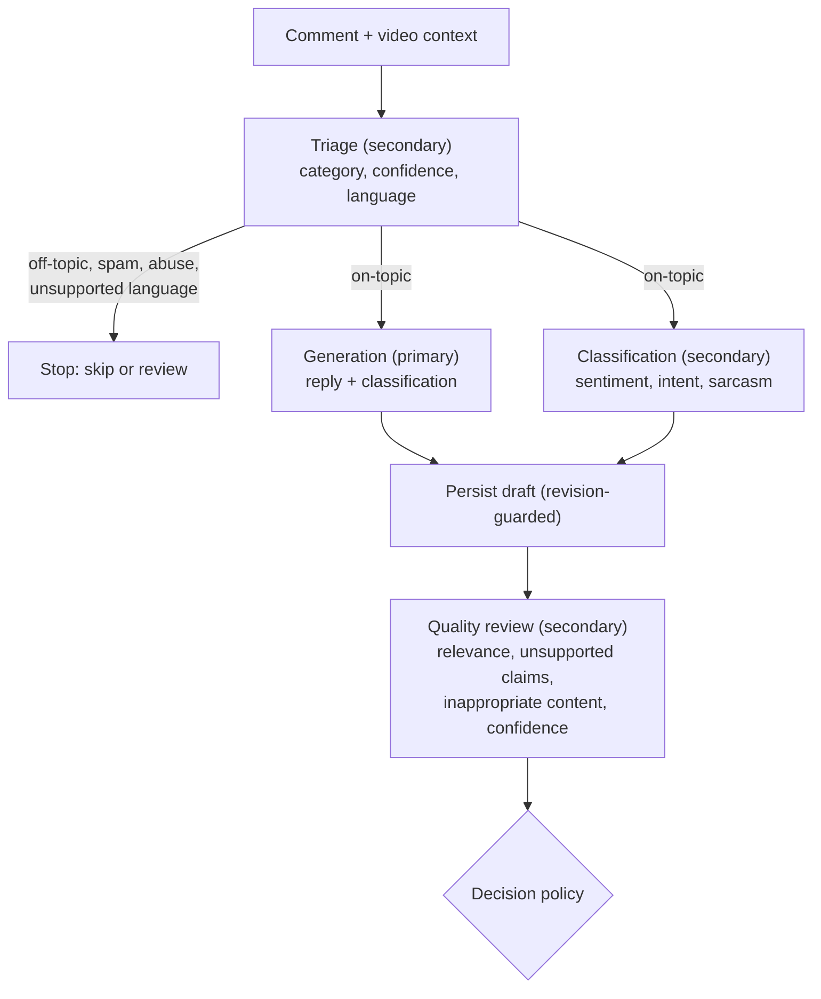
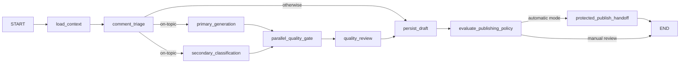
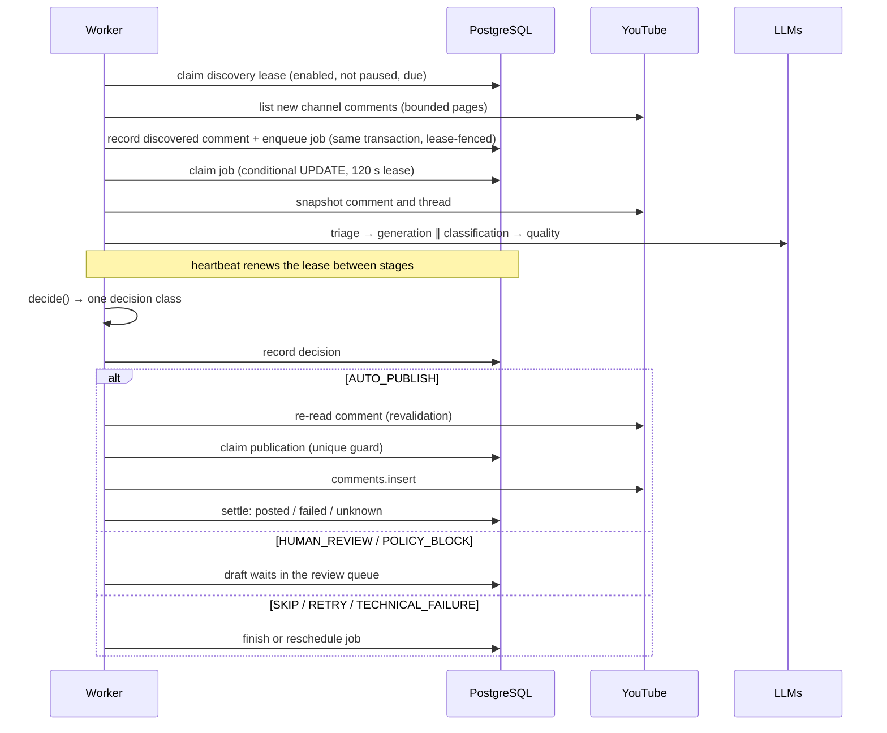
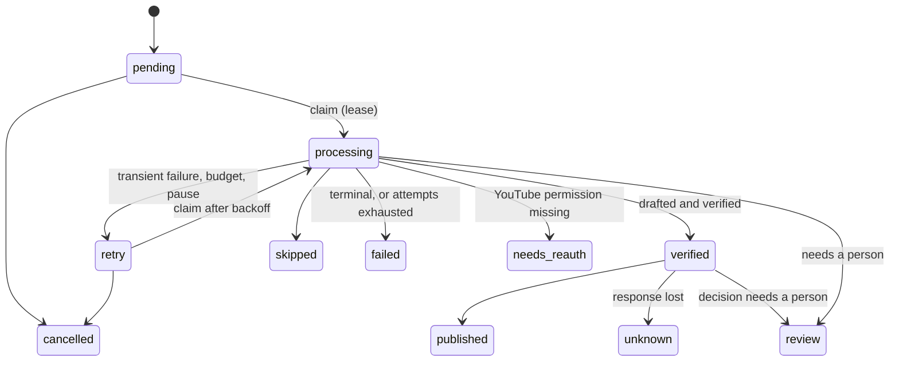
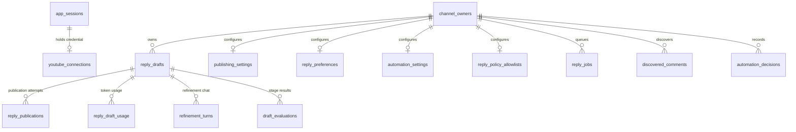

# Architecture

This document explains how ReplyAI is put together: the runtime processes, the request
and job flows, the model pipeline, the decision policy that controls automatic
publication, and the database invariants that keep publication safe.

- [System overview](#system-overview)
- [Backend modules](#backend-modules)
- [Frontend](#frontend)
- [Authentication and YouTube access](#authentication-and-youtube-access)
- [The model pipeline](#the-model-pipeline)
- [Automatic comment processing](#automatic-comment-processing)
- [The automation decision policy](#the-automation-decision-policy)
- [Guardrails](#guardrails)
- [Publication safety](#publication-safety)
- [Rate limits and budgets](#rate-limits-and-budgets)
- [Data model](#data-model)
- [Simulation mode](#simulation-mode)

## System overview

ReplyAI runs as three local processes plus two data services:

| Process | Entry point | Responsibility |
| --- | --- | --- |
| API | `uvicorn app.main:app` | REST API for the web app, Google OAuth, drafting, publication |
| Worker | `python -m app.worker` | Comment discovery, the durable job queue, background drafting and publication |
| Web app | `npm run dev` (Vite) | React single-page workspace |
| PostgreSQL 17 | `compose.yaml` | All durable state, including the job queue, leases, rate-limit counters and publication guards |
| Redis 7 | `compose.yaml` | 24-hour cache of video metadata (best-effort; the app keeps working if it is down) |



The API and the worker share one codebase and one database. Neither keeps safety-relevant
state in memory: claims, leases, budgets and publication reservations are rows guarded by
conditional `UPDATE`s and unique indexes, so any number of API or worker processes can
run side by side.

## Backend modules

```text
backend/app/
├── main.py              App factory: CORS, routers, OAuth log redaction, simulation hook
├── config.py            Typed settings (pydantic-settings, read from backend/.env)
├── database.py          Async engine and session factory
├── worker.py            Lease-based queue worker and discovery loop
├── simulation.py        Development-only fake YouTube channel and scripted models
├── middleware/          Redaction of OAuth codes from URLs and access logs
├── models/              SQLAlchemy 2 ORM models (one module per aggregate)
├── routers/             FastAPI routers (HTTP boundary, ownership and CSRF checks)
└── services/            Domain logic, independent of HTTP
```

The most important services:

| Module | Responsibility |
| --- | --- |
| `services/llm.py` | OpenAI-compatible chat-completions adapter, strict output schemas (`Triage`, `Classification`, `Generation`, `Quality`), agreement rule |
| `services/prompts.py` | Stage instructions sent to the models |
| `services/stage_pipeline.py` | The single stage sequence used by every execution path |
| `services/stage_inputs.py` | The provider-input contract: exactly what each stage receives |
| `services/stage_outcomes.py` | Typed failure taxonomy (transient, budget, invalid output, terminal) |
| `services/draft_workflow.py` | Stage calls with timeouts and revision-guarded persistence |
| `services/draft_graph.py` | LangGraph orchestration of the same stages (optional engine) |
| `services/job_queue.py` | Durable job claims, leases, retries, recovery, shared budgets |
| `services/job_pipeline.py` | Processing one job: snapshot, triage, generate, verify, decide, publish |
| `services/discovery.py` | Bounded, lease-fenced polling of new channel comments |
| `services/automation_policy.py` | `decide()`: the one function that classifies every automatic decision |
| `services/automation_decisions.py` | Durable decision history for the dashboard and review queue |
| `services/input_analysis.py` | Deterministic input signals (hidden characters, confusable URLs, injection phrases) |
| `services/reply_policy.py` | Deterministic reply-content rules R1–R11 |
| `services/revalidation.py` | Re-reads the comment before publication (edited, deleted, already answered) |
| `services/publishing.py` | Publication eligibility, guard bookkeeping |
| `services/publication_reconcile.py` | Read-only check of unknown publication outcomes |
| `services/routing.py` | Optional tiered routing that skips model calls that cannot change the outcome |
| `services/llm_budget.py` | Per-HTTP-attempt request budgets for model calls |
| `services/youtube_api.py` | YouTube Data API calls with typed error mapping |

Routers stay thin: they authenticate the session, verify that the channel belongs to the
caller, check the CSRF header on mutations, and delegate to services.

## Frontend

The web app is a React 19 + TypeScript single-page application built with Vite and
styled with Tailwind CSS v4. It uses hash routing (`#videos`, `#inbox`, …), so it can be
served as static files.

| Path | Purpose |
| --- | --- |
| `src/App.tsx` | Route switch, OAuth result notices, unsaved-changes guard |
| `src/components/AppShell.tsx` | Navigation, connection status, simulation banner |
| `src/hooks/useAppData.ts` | Session, channel and video state shared by pages |
| `src/lib/api.ts` | `fetch` wrapper: credentials, CSRF header, typed `ApiError` |
| `src/lib/types.ts` | TypeScript mirrors of the API payloads |
| `src/DraftPanel.tsx` | Draft workspace: generate, review, refine, edit, confirm and publish |
| `src/pages/*Page.tsx` | Videos, comment inbox, posted history, jobs, automation, review queue, settings |

All state that matters lives on the server; the client re-fetches after every mutation
rather than predicting the result.

## Authentication and YouTube access

- Google OAuth 2.0 authorization-code flow with PKCE (`routers/auth.py`,
  `services/google_oauth.py`). The callback `state` is single-use and expires.
- The first connection asks only for `youtube.readonly`. Reading comment threads and
  posting replies requires `youtube.force-ssl`, requested through a separate, explicit
  **Update YouTube permissions** step.
- Access and refresh tokens are encrypted at rest with Fernet (`TOKEN_ENCRYPTION_KEY`).
- The browser holds only an opaque, HTTP-only session cookie; the server stores a hash of
  it. Mutating requests require an `X-CSRF-Token` header and an allowed `Origin`.
- OAuth `code` and `state` values are redacted from URLs and access logs
  (`middleware/sensitive_query.py`).
- Data belongs to the verified **channel** (`channel_owners`), not to a browser session,
  so logging out or reconnecting never destroys drafts. See
  [data-retention.md](data-retention.md).

## The model pipeline

ReplyAI uses two independently configured models through any OpenAI-compatible
chat-completions API (JSON mode, strict Pydantic schemas, no tools, no streaming):

| Role | Stages | Default (Groq) |
| --- | --- | --- |
| **Primary** | Generation: writes the reply and classifies the comment | `openai/gpt-oss-120b` |
| **Secondary** | Triage, independent classification, and quality review of the saved reply | `openai/gpt-oss-20b` |

Every execution path (the interactive UI, the LangGraph engine, the background worker)
runs the same stage sequence from `services/stage_pipeline.py`:



**Triage** decides whether the comment deserves a reply at all, using a "scope card":
video title, a description excerpt, parsed chapter lines and the channel title.

**Agreement** is defined on the two classifications' `sentiment` and `intent` labels
only (`llm.agreement`). Optional fields such as sarcasm or language never turn agreement
into disagreement; they are evaluated separately by the decision policy.

**Persistence** is revision-guarded: a result is written only if the draft still has the
revision the stage started from, so a slow model response can never overwrite a newer
human edit (`draft_workflow.persist_result`).

**Failures are typed** (`services/stage_outcomes.py`). Rate limits, timeouts and network
errors are infrastructure outcomes that lead to a retry or a technical failure; they are
never mistaken for a content judgement that sends a comment to human review.

### The two engines

`DRAFT_WORKFLOW_ENGINE=legacy` (default) runs the stages as sequential function calls in
`routers/drafts.py`. `DRAFT_WORKFLOW_ENGINE=langgraph` runs the same stages as a LangGraph
`StateGraph` (`services/draft_graph.py`):



Both engines use identical provider inputs (one contract in `stage_inputs.py`) and hand
publication to the same guarded function.

## Automatic comment processing

Automation is **off by default** and is enabled per channel on the Automation page.



### Discovery

`services/discovery.py` polls each enabled channel at most every `DISCOVERY_POLL_SECONDS`
(default 300 s), reading at most `DISCOVERY_MAX_PAGES_PER_POLL` pages. A poll holds a
short lease on the channel's `automation_settings` row; every page of results is
committed only while that lease is still held and automation is still enabled and not
paused. The discovery cursor advances only after a complete listing, so a truncated poll
never hides older comments. Comments written by the channel itself, comments older than
the cursor, and comments that already have a draft are recorded but not queued.

### The job lifecycle

`reply_jobs` is a durable queue in PostgreSQL (`services/job_queue.py`):



Active statuses are `pending`, `retry`, `processing` and `verified` (`publish_claimed`
is reserved in the schema but not currently written); `published`, `review`, `skipped`,
`failed`, `unknown`, `cancelled` and `needs_reauth` are terminal.

When a worker dies, recovery treats durable publication state as the only evidence: if
the job's draft has an open publication attempt, the job becomes `published` (attempt
posted) or `unknown` (anything else) and is never retried; otherwise it returns to
`pending`, or `failed` once its recovery cap is exhausted.

- **Claims** are conditional `UPDATE`s, so two workers can never own the same job.
- **Leases** last 120 s and are renewed by heartbeats between model stages. A worker that
  loses its lease stops before spending on the next stage.
- **Recovery** passes and provider retries have separate caps, so a crash loop cannot
  hide behind retries and a retry storm cannot hide a crash loop.
- **Resumption**: a job that crashes after verification resumes at publication instead
  of paying for generation again.
- A per-channel concurrency cap is derived from live leases, so it heals itself when a
  worker dies.

## The automation decision policy

`services/automation_policy.decide()` is a pure function that maps everything known about
one draft to exactly one class:

| Class | Meaning | What happens |
| --- | --- | --- |
| `AUTO_PUBLISH` | Every check passed | Reply is published (or recorded only, in dry-run mode) |
| `HUMAN_REVIEW` | A person should decide | Draft appears in the review queue |
| `SKIP` | No reply is appropriate | Job finishes; nothing is posted |
| `POLICY_BLOCK` | Reply content violates a deterministic rule | Held for a person; never auto-published |
| `RETRY` | Temporary condition | Job is rescheduled with backoff |
| `TECHNICAL_FAILURE` | Not recoverable automatically | Job fails with a sanitized reason |

Checks run in a fixed order and the first match wins:

1. **Infrastructure** — any stage that failed for a technical reason → `RETRY` or
   `TECHNICAL_FAILURE`. This always comes first, so an outage can never become a content
   decision.
2. **Credentials** — missing or insufficient YouTube permission → `TECHNICAL_FAILURE`.
3. **Owner switches** — paused → `RETRY`; disabled → `HUMAN_REVIEW`.
4. **External state** — the channel's own comment, a deleted comment, or a comment the
   creator already answered → `SKIP`; an edited comment → `HUMAN_REVIEW`.
5. **Triage** — spam, abuse, off-topic or unsupported language → `SKIP`; "requires human
   attention", uncertain or generic engagement → `HUMAN_REVIEW`.
6. **Content signals** — language mismatch, a question only the creator can answer,
   high-risk segments of a multi-intent comment, or possible sarcasm → `HUMAN_REVIEW`;
   hidden-character concealment (when `INPUT_SIGNALS_MODE=route_high_risk`) →
   `POLICY_BLOCK`.
7. **Verification** — incomplete stages, uncertain labels, a quality check that did not
   pass, review confidence below 0.8, any review finding, or model disagreement →
   `HUMAN_REVIEW` (inappropriate content → `POLICY_BLOCK`).
8. **Reply policy** — any blocking rule R1–R11 → `POLICY_BLOCK`.
9. **Two-model invariant** — the generator and verifier must be different, recorded
   models and every stage must have run → otherwise `TECHNICAL_FAILURE`.
10. **Mode and caps** — manual mode → `HUMAN_REVIEW`; hourly/daily cap reached → `RETRY`;
    publishing mode changed since the job started → `HUMAN_REVIEW`.
11. Otherwise → `AUTO_PUBLISH`.

Model agreement is therefore **necessary but never sufficient**. Every decision is stored
in `automation_decisions` with its reasons and a snapshot of the inputs, which powers the
decision trace in the UI.

### Publishing modes

| Mode | Behaviour |
| --- | --- |
| `manual_review` (default) | Nothing is posted without a person confirming the exact text |
| `dry_run` | Every decision is made and recorded, but nothing is sent to YouTube |
| `auto_on_agreement` | Replies classed `AUTO_PUBLISH` are posted automatically |
| `approve_all` | Same eligibility rules as `auto_on_agreement`, labelled separately in the UI |

## Guardrails

**Input signals** (`services/input_analysis.py`) are deterministic detectors for
concealment: Unicode tag characters, bidirectional controls, invisible characters inside
words, confusable or punycode URL hosts, encoded payloads, and common injection phrases
(English and Hindi/Hinglish). By default they are observe-only (`INPUT_SIGNALS_MODE=observe`);
`route_high_risk` blocks automatic publication when a high-risk signal is present. The
original text is never rewritten for storage.

**Reply policy** (`services/reply_policy.py`) checks the saved reply text:

| Rule | Checks | Default level |
| --- | --- | --- |
| R1 | Personal data echoed from the comment (email, phone, UPI ID, PAN, Aadhaar) | block |
| R2 | Contact details not on the owner's allow-list | review |
| R4 | URLs: not allow-listed, copied from the comment, shorteners, IPs, punycode | review / block |
| R5 | `@handles` other than the commenter's | review |
| R6 | Commitments and promises ("I'll upload tomorrow", "pakka", "कल तक") | review |
| R7 | Promotion or money language | review |
| R8 | Claims of authority or official status | review |
| R9 | Hidden characters in the reply | block |
| R10 | Overlong reply | warn |
| R11 | Evaluation canary string | block |

In manual mode violations are shown as warnings to the person approving the reply; in
automatic modes any rule at `review` level or above prevents automatic publication.
Allowed domains, contacts and handles are managed per channel under **Settings →
Automatic operation**.

**Prompt-injection posture.** The models have no tools and no ability to act; their output
is validated against strict schemas, checked by the reply policy, and published only
through the guarded path below. This limits what a successful injection can achieve, but
it does not make the models immune to it.

## Publication safety

`routers/publication.py` is the only code path that writes to YouTube. Its order of
operations is the safety property:

1. **Check** eligibility, permissions and caps, and refresh the credential.
2. **Revalidate** the source comment (`services/revalidation.py`): if it was edited
   (SHA-256 of the text and `updatedAt` differ from the snapshot), deleted, or already
   answered by the creator, nothing is posted.
3. **Claim** in one transaction: create the attempt, reserve the parent comment in
   `published_reply_guards`, and lock the draft with an operation token.
4. **Send** `comments.insert`.
5. **Settle** the attempt as `posted`, `failed`, or `unknown`.

Invariants enforced by the schema rather than by convention:

- `published_reply_guards` has a unique `(channel_id, parent_comment_id)`: ReplyAI can
  reserve at most one reply per comment, even after the draft is deleted.
- A partial unique index allows only one open attempt per draft.
- An attempt is committed **before** the request is sent, so a lost response leaves a
  durable record instead of an invisible public reply.

**Unknown outcomes.** If YouTube's response is lost (timeout, connection reset), the
attempt is marked `unknown` and is **never retried automatically**. The draft page offers
**Check YouTube**, a read-only search of the thread for a matching reply
(`services/publication_reconcile.py`), after which a person records `posted` or
`not_posted`.

## Rate limits and budgets

All budgets are shared across processes through `rate_limit_counters`, using atomic
upserts (`job_queue.try_acquire`):

| Budget | Setting | Default |
| --- | --- | --- |
| LLM requests per minute / day | `LLM_REQUESTS_PER_MINUTE`, `LLM_REQUESTS_PER_DAY` | 28 / 900 |
| YouTube reads per minute | `YOUTUBE_READS_PER_MINUTE` | 30 |
| YouTube quota units per day | `YOUTUBE_UNITS_PER_DAY_BUDGET` | 8000 |
| Automatic replies per hour / day | `AUTO_PUBLISH_MAX_PER_HOUR`, `AUTO_PUBLISH_MAX_PER_DAY` | 10 / 50 |

LLM budgets are charged per HTTP attempt (including provider-level retries) in their own
short transaction, so the counter reflects requests actually sent. Provider token usage
is recorded per draft in `reply_draft_usage` and shown on the draft's usage panel.

## Data model



`published_reply_guards`, `queue_workers` and `rate_limit_counters` are standalone tables
keyed by channel/comment, worker id, and budget window respectively. Migrations live in
`backend/alembic/versions/` and are additive.

## Simulation mode

`REPLYAI_SIMULATION=1` (used by `scripts/dev.sh start sim`) replaces only the network
edges: the YouTube API becomes a fake channel stored in a local JSON file, and both
models become deterministic scripts chosen by comment scenario (safe, disagreement, spam,
PII, URL, sarcasm, Hindi, Hinglish, hidden characters, rate limit, and more). Everything
in between — triage routing, the decision policy, the reply policy, the queue, leases,
caps and the publication guard — is the real code.

Simulation refuses to start unless `APP_ENVIRONMENT=development` and the database name
ends in `_sim`, so simulated data can never be written into a real database. The UI
shows a persistent **Simulation mode** banner and a panel for adding scenario comments.
